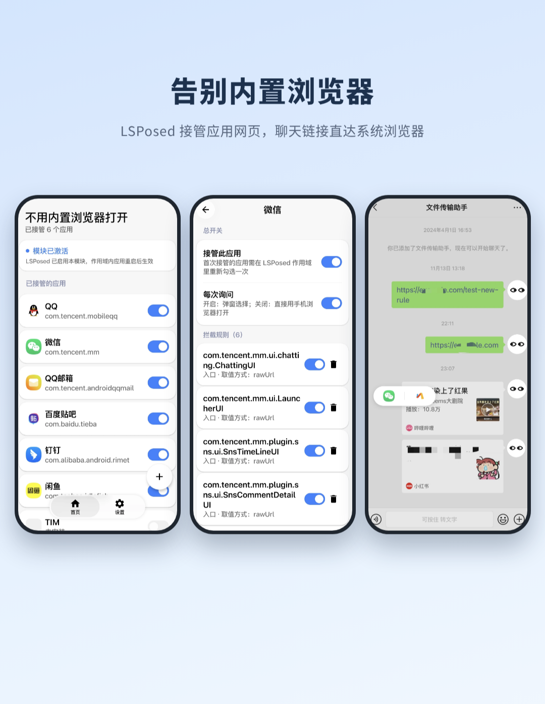

# 不用内置浏览器打开

一个 LSPosed 模块：在微信、QQ、TIM、QQ邮箱、钉钉、百度贴吧、闲鱼里点击链接时，把链接从应用内置浏览器里抢出来，交给你自己的浏览器打开。

- 包名：`io.github.sol01st.nobrowser`
- 运行环境：Xiaomi HyperOS 4 · Android 17
- 源码与反馈：<https://github.com/SoL01St/exlindev>

  

**默认接管：QQ、微信、QQ邮箱、百度贴吧、钉钉、TIM、闲鱼。其他应用点右下角 `+` 添加，需自行添加规则。**

## 功能

- **入口白名单**：只拦截已登记的发起方点出的链接，扫码、钱包、服务页等默认放行
- **可选弹窗**：每次询问，或直接交给手机浏览器
- **外链中转解包**：闲鱼、QQ 邮箱、钉钉自动还原真实地址
- **规则引擎**：Activity 通配、单条启停、白名单 `=host`
- **免 root**：作用域与配置走 LSPosed 接口（模块日志需 root）
- **隐藏桌面图标**：关掉桌面图标后仍可从 LSPosed 模块设置进入
- **实时生效**
- **备份恢复**、JSON 导入导出

## 安装

1. 从 [Releases](https://github.com/SoL01St/exlindev/releases) 下载 APK 安装
2. 在 LSPosed 中启用本模块，勾选所需应用作用域，重启目标应用
3. 在模块内打开所需应用的接管开关
4. 胶囊位置拖动后，如需每个应用弹出胶囊保持位置统一，请授予自启动权限

## 致谢

- 拦截规则与整体思路：[xloger/ExLink](https://github.com/xloger/ExLink)
- 模块框架：[libxposed/api](https://github.com/libxposed/api)
- 界面组件：[compose-miuix-ui/miuix](https://github.com/compose-miuix-ui/miuix)

## License

MIT
